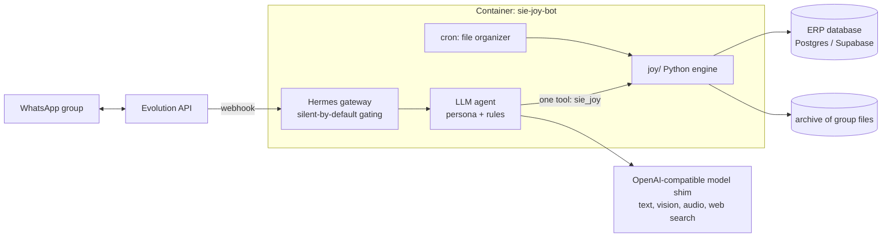

<div align="center">

# 🛍️ SIÉ JOY Bot ("Hermes")

### A WhatsApp operations copilot that turns a group chat into bookkeeping, a decision ledger and an organized file archive

*An LLM agent for a retail-store launch: it stays silent until called, books expense reimbursements in an ERP, refuses to treat a quote as a purchase, and files every document that passes through the chat.*


</div>

---

## The problem

Opening a physical store means dozens of purchases, quotes, receipts and half-decided ideas flying through a WhatsApp group.
The founders paid every expense from a personal account (the company bank account was not open yet) and each one had to be
**reimbursed on a fixed date** and booked against the right account in the ERP. Doing that by hand meant lost receipts,
duplicate entries and "did we actually buy that or just talk about it?" arguments.

## The solution

**Hermes** is an agent living in the group chat. It listens to everything (text, voice notes, photos of receipts, PDFs) but
**only answers when called**, and it follows one golden rule: *something only counts as done when someone clearly says so*
("paid", "done", "invoice attached"). Quotes and brainstorming stay open.

## 💬 How it behaves in the group

- A supplier is paid by Pix and a receipt photo is posted. When someone says "Hermes, book this reimbursement", it OCRs the receipt, books it in the ERP (supplier, amount, ledger account, cost center, due date = the 10th of next month) and replies with a summary.
- A quote or an idea is kept as an **open pending item** and never booked until someone writes "done", "paid" or attaches the invoice.
- Asked to book the same amount twice, the tool flags a **possible duplicate** and Hermes asks instead of repeating. Corrections **edit** the existing entry; negative entries are never created.

## ✨ Features

| Capability | How it works |
|---|---|
| 💸 **Reimbursement bookkeeping** | `lancar_reembolso`, `editar_reembolso`, `cancelar_reembolso`, `listar_reembolsos`, `sincronizar_reembolsos` write to the ERP (`fin.reimbursements` in Postgres/Supabase). Duplicate detection, known-supplier lookup and an explicit "ERP did not confirm" error path. |
| 📒 **Decision ledger** | `registrar_pendencia` / `atualizar_pendencia`: an item becomes *effected* only with a **quoted piece of evidence** from the chat. |
| 🗂️ **Automatic file archive** | A cron job (every 30 min) classifies and stores every document that passes through the group (Drive sync via rclone is documented in `ops/DRIVE.md`). |
| 🧾 **Packing-list audit** | `relatorio_romaneio` reads a supplier's PDF packing list, cross-checks it with the ERP catalog and the incoming invoice, and generates a conference report. |
| 📈 **Plan lookup** | Capex/opex plan queries (`resumo_capex`, `consultar_planejamento`) so budget questions get numbers from the plan, not from the model's memory. |
| 🔎 **Shopping research** | Web search that prefers marketplace listings and must return a **direct product link** (it is forbidden to invent links). |
| 🎙️ **Multimodal input** | Voice notes are transcribed, receipts/photos are OCR'd and read as normal context. |
| 🧵 **Reply chains** | When someone replies to a message, the agent sees the whole thread, not only the quoted line. |

## 🏗️ Architecture



**Engineering notes**

- **One tool, many queries.** All business logic lives in `joy/core.py`, a single query router. The model never touches the
  database directly, which keeps behavior testable and auditable.
- **Evidence over inference.** The ledger and the booking flow refuse to proceed on ambiguous messages. Ambiguity produces a
  one-line question, not an action.
- **Hardened container.** Pinned image digest, `no-new-privileges`, 1 GB / 1 CPU / 256 PIDs limits, healthcheck, ports bound to
  `127.0.0.1`, and secrets only via `data/.env`.
- **Deterministic side effects.** Relative dates ("yesterday", "Friday", "dd/mm") are resolved in code, not by the model.

## 📁 Repository layout

| Path | What |
|---|---|
| `joy/core.py` | query router for the `sie_joy` tool |
| `joy/financeiro.py` | reimbursement booking and sync with the ERP |
| `joy/pendencias.py` | decision ledger with evidence |
| `joy/arquivos.py`, `joy/documentos.py` | file archive, PDF/image/audio reading |
| `joy/romaneio.py` | packing-list conference report (needs `reportlab`, `pypdf`) |
| `joy/planejamento.py`, `joy/pesquisa.py` | plan lookup, web/product research |
| `joy/group_history.py`, `joy/reply_chain.py` | append-only chat history, thread context |
| `ops/` | cron setup (`crons.sh`), Drive sync scripts, WhatsApp history importer |
| `tests/` | offline test suite (`test_core.py`) and a message simulator (`fire_joy.py`) |
| `docker-compose.yml` · `data/config.yaml` · `data/.env.example` | deployment |

## 🚀 Run it

Requires Docker, an [Evolution API](https://github.com/EvolutionAPI/evolution-api) instance, an OpenAI-compatible LLM endpoint
and the [Hermes Agent](https://hub.docker.com/r/nousresearch/hermes-agent) image.

```bash
git clone https://github.com/pjaragao/sie-joy-bot.git && cd sie-joy-bot
pip install reportlab pypdf charset-normalizer     # only needed for the packing-list report
cp data/.env.example data/.env                      # fill in Evolution, ERP and model credentials
docker compose up -d
ops/crons.sh --apply                                # install the scheduled jobs
```

Tests (offline, no network or ERP needed):

```bash
SUPABASE_URL=http://127.0.0.1:1 SUPABASE_SERVICE_ROLE_KEY=x JOY_DIR=$PWD/joy HERMES_HOME=/tmp/joy-test python3 tests/test_core.py
```

> The agent persona prompt, the real chat history and all credentials are intentionally **not** in this repository.

---

<div align="center">

Built by **Paulo Aragão Jr** · [GitHub](https://github.com/pjaragao) · related: [luisa-bot](https://github.com/pjaragao/luisa-bot) · [lolo-bot](https://github.com/pjaragao/lolo-bot) · [mr-irrelevant](https://github.com/pjaragao/mr-irrelevant)

</div>
